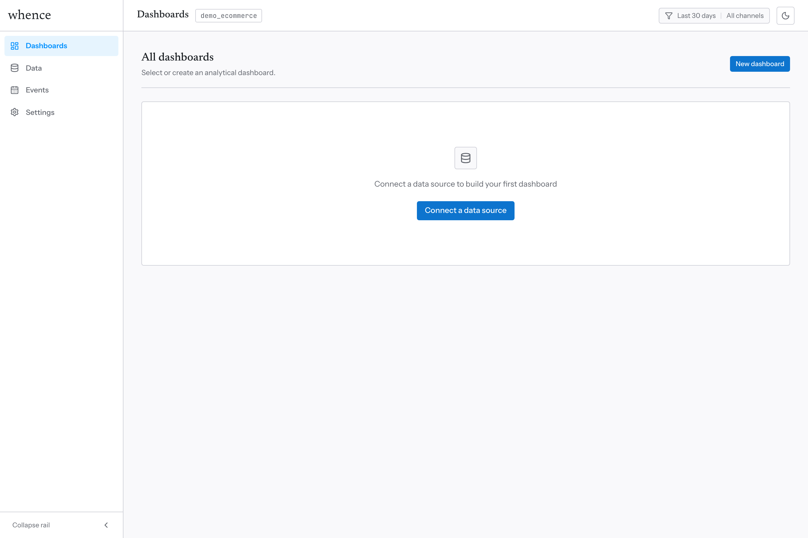
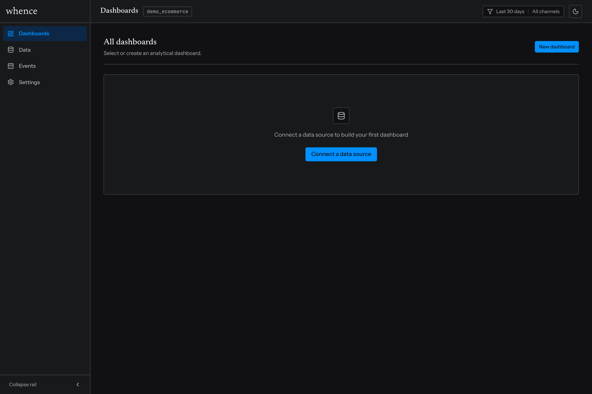
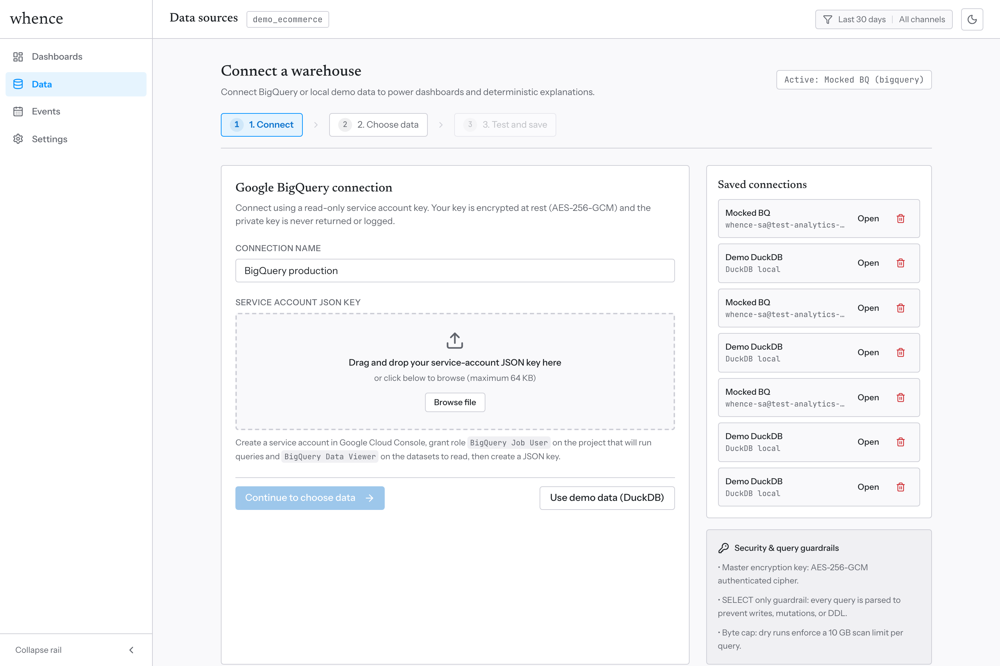
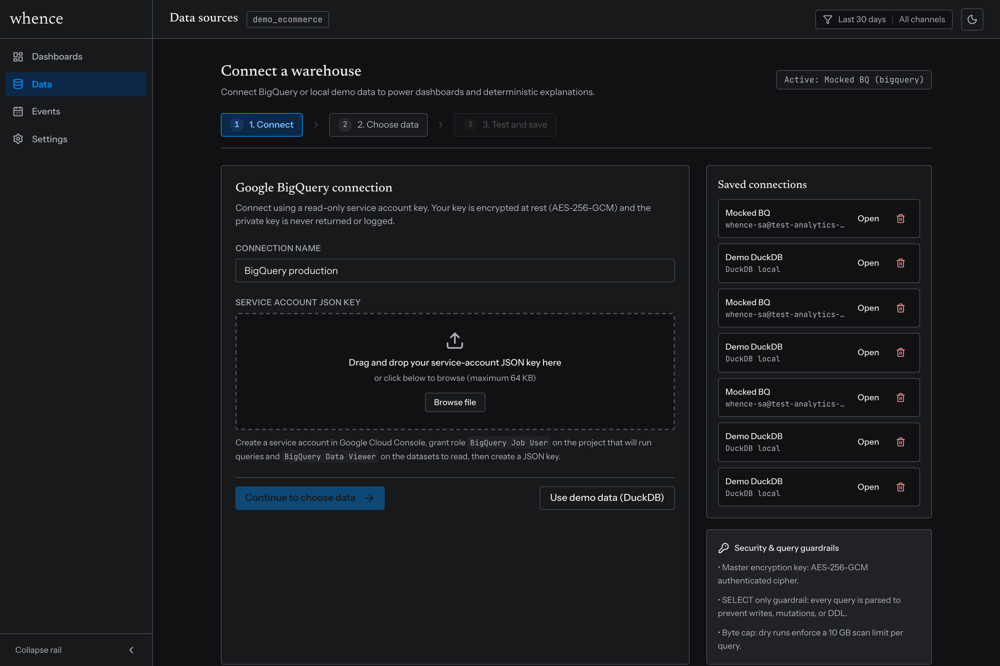
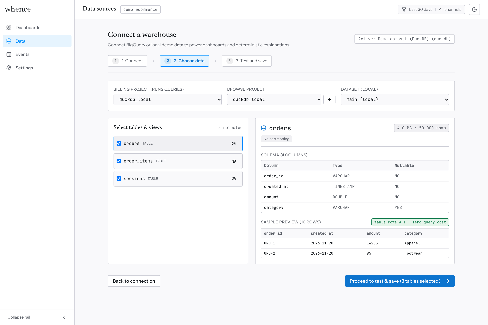
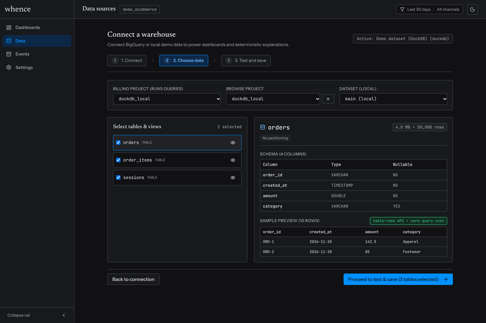
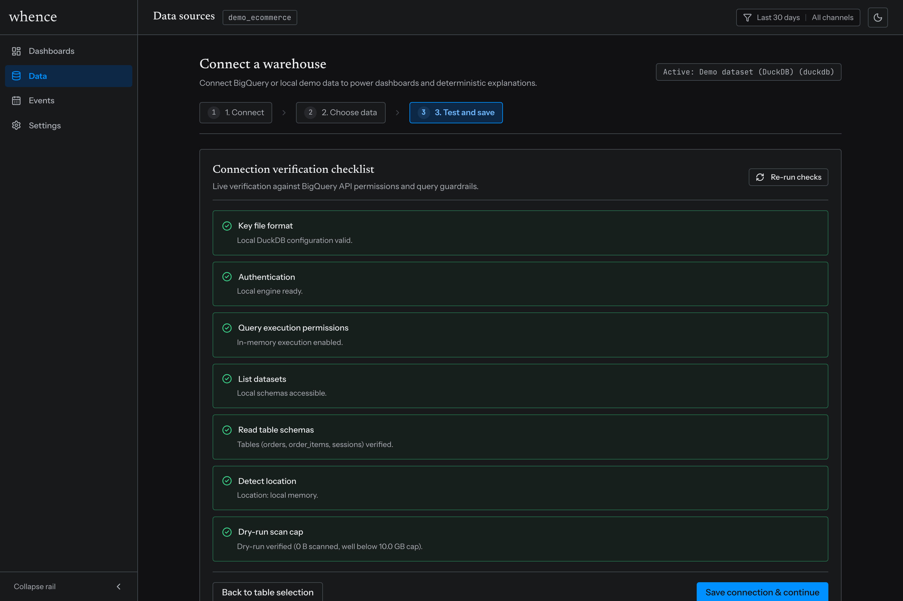
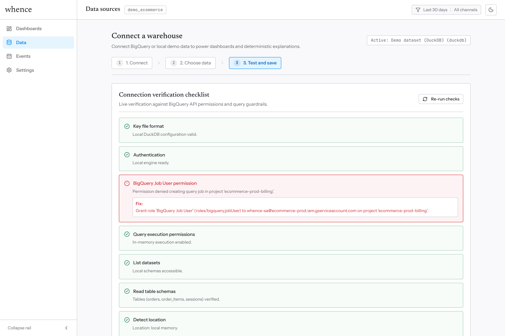
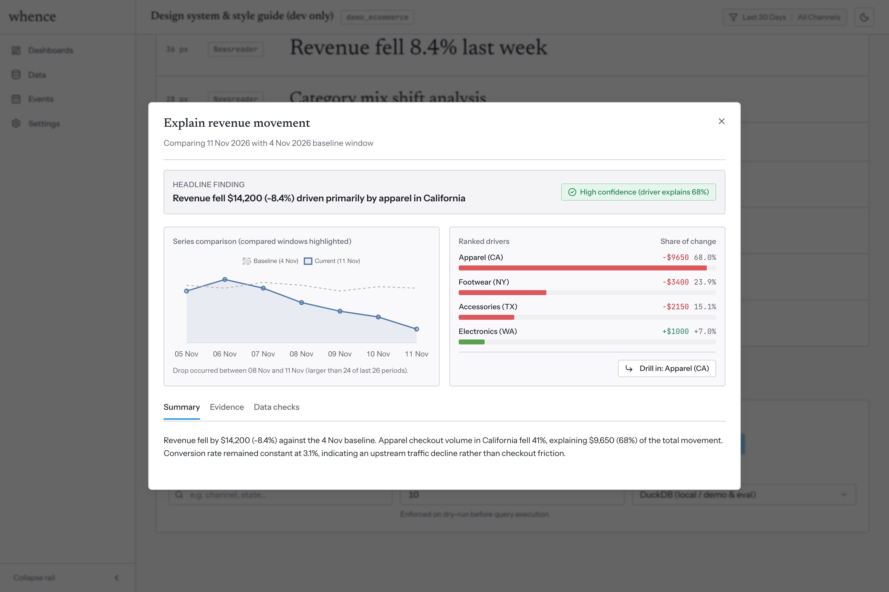
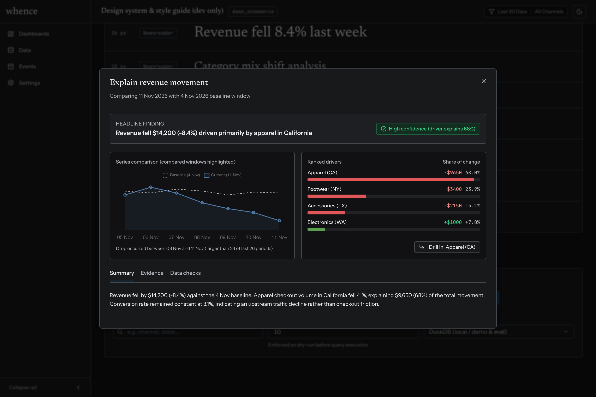

# Whence

> **Whence**: Click-to-explain analytical dashboard product connecting to Google BigQuery and DuckDB.
> Numbers, rankings, and confidence are computed by deterministic code; the language model writes up findings from verifiable evidence and never decides what the cause is.

---

## Progress tracker & phase roadmap

> **Rule**: This document is updated at every development phase to record progress, test outcomes, architectural decisions, and verification evidence.

| Phase | Description | Status | Verification & checks |
| :--- | :--- | :--- | :--- |
| **Phase 0** | **Scaffold and design system** | **Completed** | 22/22 unit tests pass (11 Vitest, 11 Pytest), strict typing clean (`tsc`, `mypy`), dev-only style guide (`/dev/style`), centred explain dialog (Radix Dialog), real Dashboards home page (`/`) with clean empty state, and WCAG AA contrast compliance verified. |
| **Phase 1** | **Prove the explanation (core engine)** | In progress | Adapters (DuckDB + BigQuery) completed; BigQuery connection verified live by user (manual test, 23 Nov 2026; automated live test remains opt-in). Warehouse connection UI completed. Next: SQL guardrail hardening, semantic layer, query compiler, explain engine, demo dashboard, eval harness (12 planted scenarios). |
| **Phase 2** | **Generate and edit** | Planned | Spec compiler, chart editor panel, drag-and-resize grid, custom metric builder, dashboard persistence. |
| **Phase 3** | **Forecast, compare, anomalies, context** | Planned | AutoETS forecast + backtest, side-by-side compare, anomaly detector, event logging and CSV import. |
| **Phase 4** | **Hardening** | Planned | Workspaces, roles, sharing links, credential rotation, rate limiting, and Playwright E2E test flows. |

---

## 1. Quick start

### Option A: Documented two-command start (local development)

#### 1. Setup virtual environment & dependencies
```bash
# Backend (Python 3.12)
python3.12 -m venv .venv
source .venv/bin/activate
pip install -r backend/requirements.txt

# Frontend & Root (Node 22+)
npm install
cd frontend && npm install && cd ..

# Environment configuration
cp .env.example .env
```

#### 2. Start services (two commands)
**Terminal 1 (Backend API):**
```bash
source .venv/bin/activate
cd backend
uvicorn app.main:app --reload --port 8000 --host 127.0.0.1
```

**Terminal 2 (Next.js Frontend):**
```bash
cd frontend
npm run dev
```

Or run both concurrently in a single terminal:
```bash
npm run dev
```

- **Dashboards (home)**: **http://localhost:3000**
- **Dev-only style guide**: **http://localhost:3000/dev/style** (active in development or when `ENABLE_STYLE_GUIDE=true`; returns HTTP 404 in production)
- **Backend health API**: **http://localhost:8000/api/v1/health**

---

### Option B: One Docker compose up

```bash
docker compose up --build
```
- Frontend: `http://localhost:3000`
- Backend API: `http://localhost:8000`

---

## 2. CI-style verification commands

Strict types and test suites are enforced across the entire monorepo:

```bash
# Run all unit tests (Vitest + Pytest)
npm run test

# Strict typechecking (TypeScript strict mode + Mypy strict)
npm run typecheck

# Code formatting and linting (ESLint + Ruff)
npm run lint

# Check formatting
npm run format:check

# Auto-format
npm run format

# Production build
npm run build
```

---

## 3. Architecture overview & project structure

> For an exhaustive, file-by-file map of all modules, subsystem responsibilities, and update rules, see [PROJECT_STRUCTURE.md](PROJECT_STRUCTURE.md).  
> For the continuous ledger of completed milestones, test metrics, and roadmap status, see [PROGRESS.md](PROGRESS.md). All three documents are maintained and updated continuously at every step.

```
Whence/
├── .env.example                 # Configuration blueprint
├── docker-compose.yml           # Unified container environment
├── Makefile                     # Standard developer commands
├── package.json                 # Monorepo orchestration scripts
├── README.md                    # Primary project overview, setup guide & CI status
├── PROGRESS.md                  # Authoritative continuous implementation progress ledger
├── PROJECT_STRUCTURE.md         # Comprehensive codebase map and module contract
├── docs/
│   └── screenshots/             # Visual verification captures (light & dark mode)
├── backend/
│   ├── app/
│   │   ├── config.py            # Pydantic v2 settings from env
│   │   ├── crypto.py            # AES-256-GCM credential encryption at rest
│   │   ├── audit.py             # Query audit logger (bytes, duration, dialect)
│   │   ├── adapters/            # Warehouse adapters behind one interface
│   │   │   ├── base.py          # WarehouseAdapter ABC + safety guardrails
│   │   │   ├── duckdb_adapter.py# DuckDB in-memory/file adapter
│   │   │   └── bigquery_adapter.py # Google BigQuery adapter (production target)
│   │   ├── semantic/            # [Phase 1 - Item 2] Semantic layer models & validation
│   │   ├── compiler/            # [Phase 1 - Item 3] Query compiler for chart types
│   │   ├── explain/             # [Phase 1 - Item 4] Standalone explain engine package
│   │   └── main.py              # FastAPI REST API (/api/v1)
│   ├── tests/                   # Pytest suite (17 tests passing)
│   ├── requirements.txt
│   └── pyproject.toml           # Strict Ruff & Mypy configuration
├── eval/                        # [Phase 1 - Item 5] Standalone evaluation harness
└── frontend/
    ├── public/
    │   └── fonts/               # Self-hosted Newsreader, Instrument Sans, JetBrains Mono
    ├── src/
    │   ├── app/
    │   │   ├── globals.css      # Radix Slate & Blue tokens, CSS variables
    │   │   ├── layout.tsx       # Root layout with self-hosted font loading
    │   │   ├── page.tsx         # Real home: Dashboards list & empty state
    │   │   └── dev/style/       # Dev-only style guide route (404 in production)
    │   ├── components/
    │   │   ├── ui/              # Base components: button, input, select, tabs, dialog, popover, toast, skeleton
    │   │   └── shell/           # AppShell with clean 4-item left rail (56px/220px)
    │   └── tests/               # Vitest component test suite (11 tests passing)
    ├── tsconfig.json            # Strict TypeScript configuration
    └── vitest.config.ts
```

---

## 4. Phase 0 deliverables & design system foundations

### Clean product navigation & real home
- **Dashboards as real home (`/`)**: Displays the dashboard overview. When no dashboard has been created, displays the exact one-sentence empty state: *"Connect a data source to build your first dashboard"* with a single button.
- **Zero scaffold artifacts**: No phase names, build statuses, or adapter-verification text in any user-facing screen.
- **Four core rail items**: Left rail strictly contains only `Dashboards`, `Data`, `Events`, and `Settings`.
- **Dev-only style guide (`/dev/style`)**:
  - Gated server-side: served only when `NODE_ENV !== "production"` or `ENABLE_STYLE_GUIDE=true`.
  - Returns HTTP 404 in production when disabled.
  - All hardcoded sample figures and demonstration fixtures are strictly confined to `/dev/style`.

### Centred explain dialog (Radix Dialog)
- Centred modal dialog: width `min(960px, 92vw)`, max-height `85vh`, internal scroll, neutral dimmed overlay.
- Full-screen sheet below 768px.
- Layout:
  - Header with headline finding and confidence rating.
  - Side-by-side view: small copy of the chart with compared windows highlighted beside the driver waterfall and ranked list.
  - "Drill in" stays inside the dialog with a breadcrumb trail (`All dimensions > Apparel (CA)`).
  - Tabs below: `Summary`, `Evidence` (windows, SQL dry-run scan, full query with copy button), `Data checks` (quality scan).
- Accessible keyboard behavior: Esc and overlay click close it, focus is trapped and returns to the clicked point on close, `aria-modal="true"` with labelled title and description.

### Color palette & design tokens (Radix UI Colors)
- **UI neutrals**: Radix Slate (`slate` in light mode, `slateDark` in dark mode):
  - Steps 1-2: backgrounds (`slate2` #f9f9fb for app canvas, #ffffff / `slateDark2` for elevated surface).
  - Steps 3-5: component backgrounds (`slate3` #f0f0f3 subtle, `slate4` #e8e8ec hover, `slate5` #e0e1e6 active).
  - Steps 6-8: borders (`slate6` #d9d9e0 subtle, `slate7` #cdced6 hairline border, `slate8` #b9bbc6 strong).
  - Steps 11-12: text (`slate12` #1c2024 primary ink, `slate11` #60646c muted text).
- **Accent**: Radix Blue:
  - Step 9 for solid (`blue9` #0090ff), step 10 for hover (`blue10` #0588f0), step 11 for text (`blue11` #0d74ce), step 3 for subtle background (`blue3` #e6f4fe).
- **Chart series palette** (in order, single color #4E79A7 by default):
  `#4E79A7`, `#F28E2B`, `#E15759`, `#76B7B2`, `#59A14F`, `#EDC948`, `#B07AA1`, `#FF9DA7`, `#9C755F`, `#BAB0AC`.
- **Increase / decrease**:
  - Radix Green (`green11` #218358 light, `greenDark11` #3dd68c dark) and Radix Red (`red11` #ce2c31 light, `redDark11` #ff9592 dark) for text, always with `+`/`-` or an arrow.
  - Dedicated waterfall bars use `#59A14F` and `#E15759` only (never mixed with series colours).

### Measured WCAG AA contrast ratios
All text, accent, and status combinations in light and dark mode meet or exceed WCAG AA standards (minimum 4.5:1 for normal text, 3:1 for large text/UI components):

| Element / pair | Background | Measured contrast | WCAG rating | Mode |
| :--- | :--- | :--- | :--- | :--- |
| Text: `slate12` (#1c2024) | `slate1` / white | **16.39:1** | Pass AAA | Light |
| Text: `slate11` (#60646c) | `slate1` / white | **5.94:1** | Pass AA (normal text) | Light |
| Text: `blue11` (#0d74ce) | `slate1` / white | **4.77:1** | Pass AA (normal text) | Light |
| Text: `green11` (#218358) | `slate1` / white | **4.72:1** | Pass AA (normal text) | Light |
| Text: `red11` (#ce2c31) | `slate1` / white | **5.21:1** | Pass AA (normal text) | Light |
| Solid accent button: white (#ffffff) | `blue11` (#0d74ce) | **4.77:1** | Pass AA | Light |
| Solid status: white (#ffffff) | `green11` (#218358) | **4.72:1** | Pass AA | Light |
| Solid status: white (#ffffff) | `red11` (#ce2c31) | **5.21:1** | Pass AA | Light |
| Text: `slateDark12` (#edeef0) | `slateDark1` (#111113) | **16.25:1** | Pass AAA | Dark |
| Text: `slateDark11` (#b0b4ba) | `slateDark1` (#111113) | **9.06:1** | Pass AAA | Dark |
| Text: `blueDark11` (#70b8ff) | `slateDark1` (#111113) | **8.97:1** | Pass AAA | Dark |
| Text: `greenDark11` (#3dd68c) | `slateDark1` (#111113) | **10.06:1** | Pass AAA | Dark |
| Text: `redDark11` (#ff9592) | `slateDark1` (#111113) | **8.95:1** | Pass AAA | Dark |
| Solid accent button: `slateDark12` (#111113) | `blueDark9` (#0090ff) | **5.78:1** | Pass AA | Dark |
| Solid status: `slateDark12` (#111113) | `greenDark11` (#3dd68c) | **10.06:1** | Pass AAA | Dark |
| Solid status: `slateDark12` (#111113) | `redDark11` (#ff9592) | **8.95:1** | Pass AAA | Dark |

### Typography
- Newsreader for wordmark and headings.
- Instrument Sans for UI text.
- JetBrains Mono for code and SQL.
- Tabular figures on numbers (`font-variant-numeric: tabular-nums`).
- Self-hosted fonts in `frontend/public/fonts/`.
- Strict scale: 12, 13, 14, 16, 20, 28, 36 px.
- Type sample rows explicitly render in the font they name.

---

## 5. Verification matrix & test results

| Check / test suite | Scope | Result | Execution time |
| :--- | :--- | :--- | :--- |
| **Backend unit tests** (`pytest`) | 24 tests across adapter introspection, query execution, dry runs, byte cap enforcement, timeouts, audit logs, BigQuery mock client tests, encrypted credential security (private key redaction), 7 live connection checks, BigQuery error mappings, hardened sqlglot guardrails (stacked queries, comment tricks, CTE-wrapped DML, external functions), and opt-in live test. **BigQuery connection verified live by user (manual test, 23 Nov 2026)**; automated live integration test remains opt-in via `WHENCE_LIVE_BQ_KEY_PATH`. | **23 passed, 1 skipped (live opt-in)** | 0.40s |
| **Frontend unit tests** (`vitest`) | 21 tests across base UI components (Button, Input, Skeleton, Dialog), the 3-step warehouse connection flow (Step 1 Connect, 64 KB key validation, DuckDB fallback, Step 2 Choose data, Step 3 Live checklist & failure states), and connection flow loading states (button loading with inline spinners, layout-matching skeletons with 200ms debounce, aria-live screen reader announcements, and check status badges). | **21 / 21 passed (100%)** | 0.85s |
| **Frontend typecheck** (`tsc --noEmit`) | Strict TypeScript check across all components, shell, data flow, and pages. | **0 errors** | 1.1s |
| **Backend typecheck** (`mypy --strict`) | Strict Mypy typecheck across all 17 Python modules in `backend/app` and `backend/tests`. | **0 errors** | 1.2s |
| **Linting** (`ruff` + `next lint`) | Ruff checks on Python backend; ESLint checks on Next.js frontend. | **0 warnings, 0 errors** | 1.5s |
| **Frontend build** (`next build`) | Production Next.js Turbopack build generating `/`, `/data`, and `/dev/style`. | **Build succeeded** | 1.2s |
| **Route gating verification** | Verified that `/dev/style` returns HTTP 404 in production mode without `ENABLE_STYLE_GUIDE`, and returns HTTP 200 with `ENABLE_STYLE_GUIDE=true` or in development. | **Verified (404 / 200)** | Instant |
| **Section 13 compliance** | Verified against all negative constraints and positive editorial foundations. | **Compliant** | Continuous |

---

## 6. Visual verification screenshots

### Real home: Dashboards empty state
| Light mode | Dark mode |
| :--- | :--- |
|  |  |

### Step 1: Connect a warehouse (BigQuery & DuckDB alternative)
| Light mode | Dark mode |
| :--- | :--- |
|  |  |

### Step 2: Choose data (billing project, browse project, datasets, tables, zero-cost preview)
| Light mode | Dark mode |
| :--- | :--- |
|  |  |

### Step 3: Test connection — 7 live checks passed
| Light mode | Dark mode |
| :--- | :--- |
|  |  |

### Step 3: Test connection — Failure state with clear plain-language remediation
| Light mode | Dark mode |
| :--- | :--- |
|  |  |

### Centred explain dialog (from `/dev/style`)
| Light mode | Dark mode |
| :--- | :--- |
|  |  |

### Dev-only style guide (`/dev/style`)
| Light mode | Dark mode |
| :--- | :--- |
|  |  |

---

## 7. Phase 1 — Implementation status & roadmap

- [x] **Item 1: DuckDB and BigQuery adapters** — Introspection, dry run, SELECT-only guardrail, byte cap enforcement (`MAX_BYTES_SCANNED_PER_QUERY`), execution timeouts (`QUERY_TIMEOUT_SECONDS`), audit logging with label `whence`, encrypted credentials at rest (BigQuery tested against mocks, marked not live-tested).
- [x] **Item 1b: Connect a warehouse (BigQuery) in the UI** — 3-step connection flow (`/data`): service-account key upload (< 64 KB, encrypted AES-GCM at rest, private key never echoed or logged) + DuckDB demo fallback; choose billing project, browse project (plus add project by ID), datasets, tables with partitioning/clustering details and 10-row zero-cost preview (`list_rows`); 7-check live test checklist with plain-language error mapping (403 missing roles, disabled API, 404, byte cap).
- [ ] **Item 2: Semantic layer** — Models, dimensions, additive and ratio metrics with identifier validation.
- [ ] **Item 3: Query compiler** — Chart types (line, bar, stacked bar, area, KPI tile, table, scatter) across DuckDB and BigQuery dialects.
- [ ] **Item 4: Explain engine** — Standalone Python package with pipeline (8.2) and contribution math (8.3: exact rate/mix split and delta contributions).
- [ ] **Item 5: Evaluation harness** — 12 planted scenarios, DuckDB ecommerce dataset generator, accuracy & calibration benchmarks (`npm run eval`).
- [ ] **Item 6: Narrative step** — Structured narrative with number check and deterministic no-model fallback.
- [ ] **Item 7: Demo dashboard** — 5-chart ecommerce dashboard with click-to-explain and centred Explain dialog fed by real engine output.
