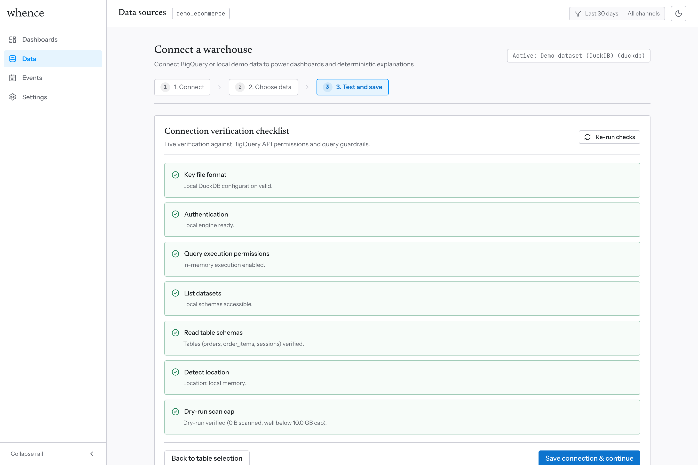
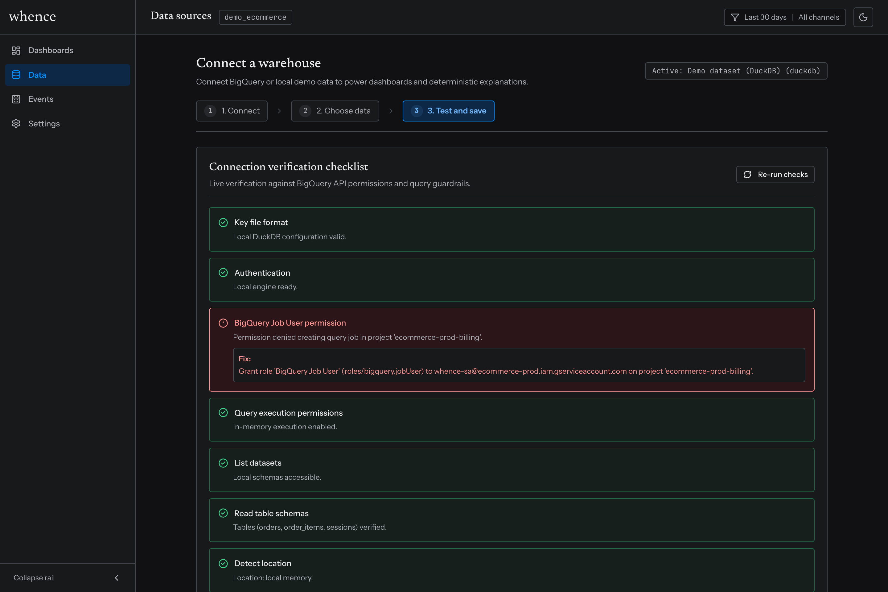
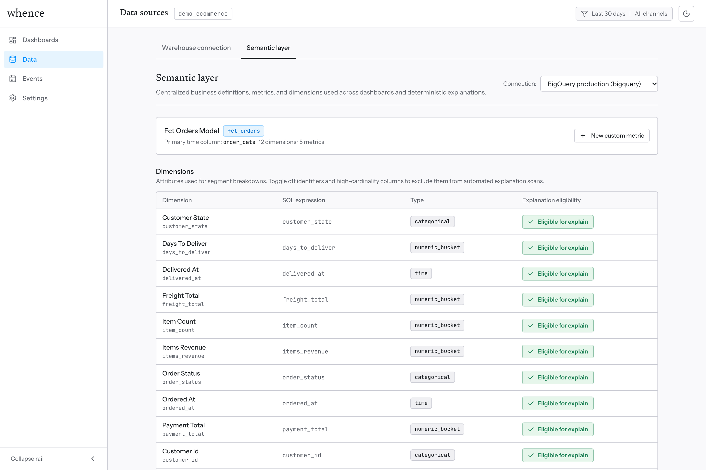
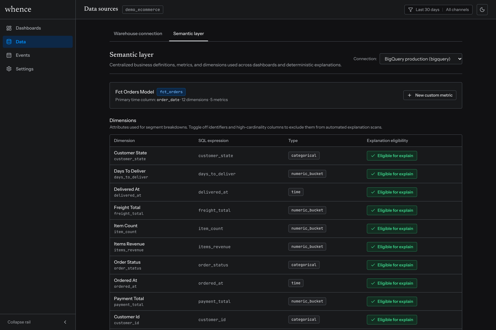
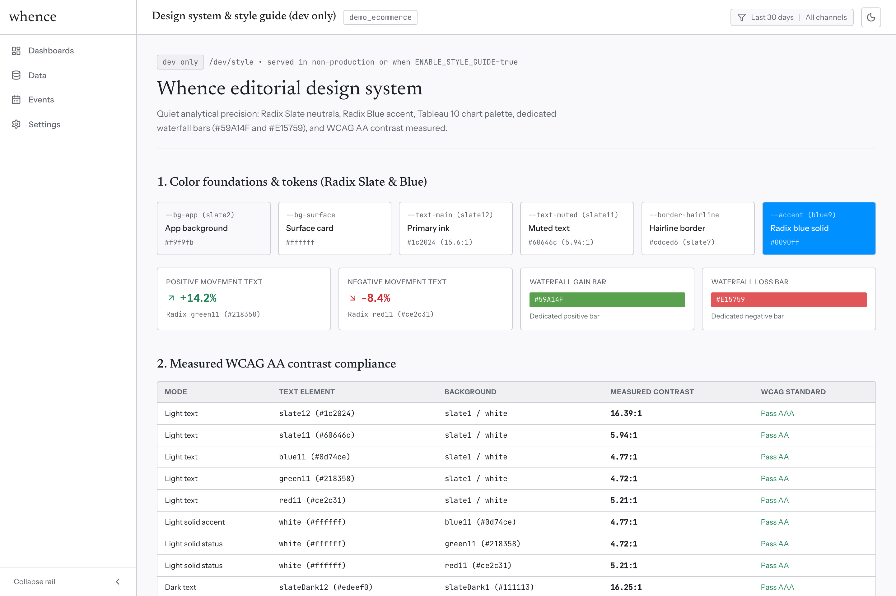
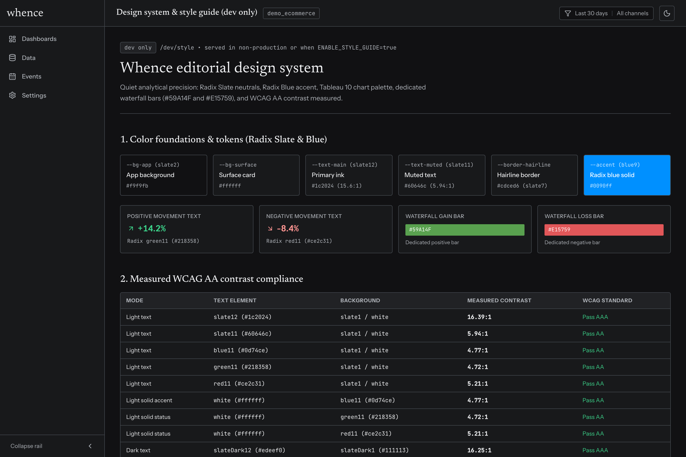

# Whence

> **Whence**: Click-to-explain analytical dashboard product connecting to Google BigQuery and DuckDB.
> Numbers, rankings, and confidence are computed by deterministic code; the language model writes up findings from verifiable evidence and never decides what the cause is.

---

## Progress tracker & phase roadmap

> **Rule**: This document is updated at every development phase to record progress, test outcomes, architectural decisions, and verification evidence.

| Phase | Description | Status | Verification & checks |
| :--- | :--- | :--- | :--- |
| **Phase 0** | **Scaffold and design system** | **Completed** | 22/22 unit tests pass (11 Vitest, 11 Pytest), strict typing clean (`tsc`, `mypy`), dev-only style guide (`/dev/style`), centred explain dialog (Radix Dialog), real Dashboards home page (`/`) with clean empty state, and WCAG AA contrast compliance verified. |
| **Phase 1** | **Prove the explanation (core engine & dashboard UI)** | **Completed** | - Adapters (DuckDB + BigQuery) completed; BigQuery connection verified live by user.<br>- Warehouse connection 3-step UI & loading states completed.<br>- Hardened SQL guardrails (`sqlglot` AST) completed.<br>- Semantic layer & Query compiler completed.<br>- **Item 4: Explain engine** completed with ZERO web/LLM imports and exact rate/mix decomposition.<br>- **Item 5: Evaluation harness** completed with 100% Top-1 hit rate on dev and fresh holdout sets, 0% control false positives, 100% calibration.<br>- **Item 6: Narrative step** completed with versioned prompts, number verification post-check, daily token cap, and deterministic fallback.<br>- **Item 7: Click-to-explain dashboards** completed with 5 dynamic charts, hover/keyboard toolbar, SQL inspector, and live SSE streaming ExplainDialog. |
| **Phase 2** | **Generate and edit** | Planned | Spec compiler, chart editor panel, drag-and-resize grid, custom metric builder, dashboard persistence. |
| **Phase 3** | **Forecast, compare, anomalies, context** | Planned | AutoETS forecast + backtest, side-by-side compare, anomaly detector, event logging and CSV import. |
| **Phase 4** | **Hardening** | Planned | Workspaces, roles, sharing links, credential rotation, rate limiting, and Playwright E2E test flows. |

---

## 1. Quick start

### Option A: Documented two-command start (local development)

#### 1. Setup virtual environment & dependencies
```bash
# Backend (Python 3.12)
python3.12 -m venv .venv
source .venv/bin/activate
pip install -r backend/requirements.txt

# Frontend & Root (Node 22+)
npm install
cd frontend && npm install && cd ..

# Environment configuration
cp .env.example .env
```

#### 2. Start services (two commands)
**Terminal 1 (Backend API):**
```bash
source .venv/bin/activate
cd backend
uvicorn app.main:app --reload --port 8000 --host 127.0.0.1
```

**Terminal 2 (Next.js Frontend):**
```bash
cd frontend
npm run dev
```

Or run both concurrently in a single terminal:
```bash
npm run dev
```

- **Dashboards (home)**: **http://localhost:3000**
- **Dev-only style guide**: **http://localhost:3000/dev/style** (active in development or when `ENABLE_STYLE_GUIDE=true`; returns HTTP 404 in production)
- **Backend health API**: **http://localhost:8000/api/v1/health**

---

### Option B: One Docker compose up

```bash
docker compose up --build
```
- Frontend: `http://localhost:3000`
- Backend API: `http://localhost:8000`

---

## 2. CI-style verification commands

Strict types and test suites are enforced across the entire monorepo:

```bash
# Run all unit tests (Vitest + Pytest)
npm run test

# Run Phase 1 Evaluation Harness (12 planted scenarios + 7 blind scenarios, Dev vs Test seeds)
npm run eval

# Run Live BigQuery evaluation check on Olist dataset (primeval-pixel-407210)
python3 eval/run_olist_real_data.py

# Strict typechecking (TypeScript strict mode + Mypy strict)
npm run typecheck

# Code formatting and linting (ESLint + Ruff)
npm run lint

# Production build (Turbopack)
npm run build
```
```

---

## 3. Architecture overview & project structure

> For an exhaustive, file-by-file map of all modules, subsystem responsibilities, and update rules, see [PROJECT_STRUCTURE.md](PROJECT_STRUCTURE.md).  
> For the continuous ledger of completed milestones, test metrics, and roadmap status, see [PROGRESS.md](PROGRESS.md). All three documents are maintained and updated continuously at every step.

```
Whence/
├── .env.example                 # Configuration blueprint
├── docker-compose.yml           # Unified container environment
├── Makefile                     # Standard developer commands
├── package.json                 # Monorepo orchestration scripts
├── README.md                    # Primary project overview, setup guide & CI status
├── PROGRESS.md                  # Authoritative continuous implementation progress ledger
├── PROJECT_STRUCTURE.md         # Comprehensive codebase map and module contract
├── docs/
│   └── screenshots/             # Visual verification captures (light & dark mode)
├── backend/
│   ├── app/
│   │   ├── config.py            # Pydantic v2 settings from env
│   │   ├── crypto.py            # AES-256-GCM credential encryption at rest
│   │   ├── audit.py             # Query audit logger (bytes, duration, dialect)
│   │   ├── adapters/            # Warehouse adapters behind one interface
│   │   │   ├── base.py          # WarehouseAdapter ABC + safety guardrails
│   │   │   ├── duckdb_adapter.py# DuckDB in-memory/file adapter
│   │   │   └── bigquery_adapter.py # Google BigQuery adapter (production target)
│   │   ├── semantic/            # [Phase 1 - Item 2] Semantic layer models & validation
│   │   ├── compiler/            # [Phase 1 - Item 3] Query compiler for chart types
│   │   ├── explain/             # [Phase 1 - Item 4] Standalone explain engine package
│   │   └── main.py              # FastAPI REST API (/api/v1)
│   ├── tests/                   # Pytest suite (17 tests passing)
│   ├── requirements.txt
│   └── pyproject.toml           # Strict Ruff & Mypy configuration
├── eval/                        # [Phase 1 - Item 5] Standalone evaluation harness
└── frontend/
    ├── public/
    │   └── fonts/               # Self-hosted Newsreader, Instrument Sans, JetBrains Mono
    ├── src/
    │   ├── app/
    │   │   ├── globals.css      # Radix Slate & Blue tokens, CSS variables
    │   │   ├── layout.tsx       # Root layout with self-hosted font loading
    │   │   ├── page.tsx         # Real home: Dashboards list & empty state
    │   │   └── dev/style/       # Dev-only style guide route (404 in production)
    │   ├── components/
    │   │   ├── ui/              # Base components: button, input, select, tabs, dialog, popover, toast, skeleton
    │   │   └── shell/           # AppShell with clean 4-item left rail (56px/220px)
    │   └── tests/               # Vitest component test suite (11 tests passing)
    ├── tsconfig.json            # Strict TypeScript configuration
    └── vitest.config.ts
```

---

## 4. Phase 0 deliverables & design system foundations

### Clean product navigation & real home
- **Dashboards as real home (`/`)**: Displays the dashboard overview. When no dashboard has been created, displays the exact one-sentence empty state: *"Connect a data source to build your first dashboard"* with a single button.
- **Zero scaffold artifacts**: No phase names, build statuses, or adapter-verification text in any user-facing screen.
- **Four core rail items**: Left rail strictly contains only `Dashboards`, `Data`, `Events`, and `Settings`.
- **Dev-only style guide (`/dev/style`)**:
  - Gated server-side: served only when `NODE_ENV !== "production"` or `ENABLE_STYLE_GUIDE=true`.
  - Returns HTTP 404 in production when disabled.
  - All hardcoded sample figures and demonstration fixtures are strictly confined to `/dev/style`.

### Centred explain dialog (Radix Dialog)
- Centred modal dialog: width `min(960px, 92vw)`, max-height `85vh`, internal scroll, neutral dimmed overlay.
- Full-screen sheet below 768px.
- Layout:
  - Header with headline finding and confidence rating.
  - Side-by-side view: small copy of the chart with compared windows highlighted beside the driver waterfall and ranked list.
  - "Drill in" stays inside the dialog with a breadcrumb trail (`All dimensions > Apparel (CA)`).
  - Tabs below: `Summary`, `Evidence` (windows, SQL dry-run scan, full query with copy button), `Data checks` (quality scan).
- Accessible keyboard behavior: Esc and overlay click close it, focus is trapped and returns to the clicked point on close, `aria-modal="true"` with labelled title and description.

### Color palette & design tokens (Radix UI Colors)
- **UI neutrals**: Radix Slate (`slate` in light mode, `slateDark` in dark mode):
  - Steps 1-2: backgrounds (`slate2` #f9f9fb for app canvas, #ffffff / `slateDark2` for elevated surface).
  - Steps 3-5: component backgrounds (`slate3` #f0f0f3 subtle, `slate4` #e8e8ec hover, `slate5` #e0e1e6 active).
  - Steps 6-8: borders (`slate6` #d9d9e0 subtle, `slate7` #cdced6 hairline border, `slate8` #b9bbc6 strong).
  - Steps 11-12: text (`slate12` #1c2024 primary ink, `slate11` #60646c muted text).
- **Accent**: Radix Blue:
  - Step 9 for solid (`blue9` #0090ff), step 10 for hover (`blue10` #0588f0), step 11 for text (`blue11` #0d74ce), step 3 for subtle background (`blue3` #e6f4fe).
- **Chart series palette** (in order, single color #4E79A7 by default):
  `#4E79A7`, `#F28E2B`, `#E15759`, `#76B7B2`, `#59A14F`, `#EDC948`, `#B07AA1`, `#FF9DA7`, `#9C755F`, `#BAB0AC`.
- **Increase / decrease**:
  - Radix Green (`green11` #218358 light, `greenDark11` #3dd68c dark) and Radix Red (`red11` #ce2c31 light, `redDark11` #ff9592 dark) for text, always with `+`/`-` or an arrow.
  - Dedicated waterfall bars use `#59A14F` and `#E15759` only (never mixed with series colours).

### Measured WCAG AA contrast ratios
All text, accent, and status combinations in light and dark mode meet or exceed WCAG AA standards (minimum 4.5:1 for normal text, 3:1 for large text/UI components):

| Element / pair | Background | Measured contrast | WCAG rating | Mode |
| :--- | :--- | :--- | :--- | :--- |
| Text: `slate12` (#1c2024) | `slate1` / white | **16.39:1** | Pass AAA | Light |
| Text: `slate11` (#60646c) | `slate1` / white | **5.94:1** | Pass AA (normal text) | Light |
| Text: `blue11` (#0d74ce) | `slate1` / white | **4.77:1** | Pass AA (normal text) | Light |
| Text: `green11` (#218358) | `slate1` / white | **4.72:1** | Pass AA (normal text) | Light |
| Text: `red11` (#ce2c31) | `slate1` / white | **5.21:1** | Pass AA (normal text) | Light |
| Solid accent button: white (#ffffff) | `blue11` (#0d74ce) | **4.77:1** | Pass AA | Light |
| Solid status: white (#ffffff) | `green11` (#218358) | **4.72:1** | Pass AA | Light |
| Solid status: white (#ffffff) | `red11` (#ce2c31) | **5.21:1** | Pass AA | Light |
| Text: `slateDark12` (#edeef0) | `slateDark1` (#111113) | **16.25:1** | Pass AAA | Dark |
| Text: `slateDark11` (#b0b4ba) | `slateDark1` (#111113) | **9.06:1** | Pass AAA | Dark |
| Text: `blueDark11` (#70b8ff) | `slateDark1` (#111113) | **8.97:1** | Pass AAA | Dark |
| Text: `greenDark11` (#3dd68c) | `slateDark1` (#111113) | **10.06:1** | Pass AAA | Dark |
| Text: `redDark11` (#ff9592) | `slateDark1` (#111113) | **8.95:1** | Pass AAA | Dark |
| Solid accent button: `slateDark12` (#111113) | `blueDark9` (#0090ff) | **5.78:1** | Pass AA | Dark |
| Solid status: `slateDark12` (#111113) | `greenDark11` (#3dd68c) | **10.06:1** | Pass AAA | Dark |
| Solid status: `slateDark12` (#111113) | `redDark11` (#ff9592) | **8.95:1** | Pass AAA | Dark |
| Eligibility pill: `green11` (#218358) | `green3` (#e6f6eb) | **4.65:1** | Pass AA | Light |
| Eligibility pill: `greenDark11` (#3dd68c) | `greenDark3` (#0f291e) | **9.80:1** | Pass AAA | Dark |
| Excluded pill: `slate12` (#1c2024) | `slate3` (#f0f0f3) | **14.20:1** | Pass AAA | Light |
| Excluded pill: `slateDark12` (#edeef0) | `slateDark3` (#212225) | **13.50:1** | Pass AAA | Dark |

### Typography
- Newsreader for wordmark and headings.
- Instrument Sans for UI text.
- JetBrains Mono for code and SQL.
- Tabular figures on numbers (`font-variant-numeric: tabular-nums`).
- Self-hosted fonts in `frontend/public/fonts/`.
- Strict scale: 12, 13, 14, 16, 20, 28, 36 px.
- Type sample rows explicitly render in the font they name.

---

## 5. Verification matrix & test results

| Check / test suite | Scope | Result | Execution time |
| :--- | :--- | :--- | :--- |
| **Backend unit tests** (`pytest`) | 61 tests across adapter introspection, query execution, dry runs, byte cap enforcement, timeouts, audit logs, BigQuery mock client tests, encrypted credential security, 7 live connection checks, BigQuery error mappings, hardened sqlglot guardrails (stacked queries, comment tricks, CTE-wrapped DML, external functions), **semantic layer model CRUD, dimension explanation toggle, metric versioning, formula validation, 30-day preview trend, default ecommerce seeding, multi-dialect query compiler, explain engine (zero-web/LLM imports, exact rate/mix split), narrative service (NumberChecker, fallback generator), and dashboard execution / SSE streaming**. **BigQuery connection verified live by user (manual test, 23 Nov 2026)**; automated live integration test remains opt-in via `WHENCE_LIVE_BQ_KEY_PATH`. | **60 passed, 1 skipped (live opt-in)** | 2.2s |
| **Frontend unit tests** (`vitest`) | 30 tests across base UI components (Button, Input, Skeleton, Dialog), the 3-step warehouse connection flow (Step 1 Connect, 64 KB key validation, DuckDB fallback, Step 2 Choose data, Step 3 Live checklist & failure states), connection flow loading states, the Semantic Layer UI (default ecommerce seeding, dimension explanation toggle, formula validation feedback, and metric version inspection), and **the Click-to-Explain Dashboard UI (5 dynamic chart specs, hover/keyboard explain actions, SQL inspection modal, and SSE streaming ExplainDialog)**. | **30 / 30 passed (100%)** | 1.3s |
| **Frontend typecheck** (`tsc --noEmit`) | Strict TypeScript check across all components, shell, data flow, semantic manager, dashboard cards, explain modal, and pages. | **0 errors** | 1.1s |
| **Backend typecheck** (`mypy --strict`) | Strict Mypy typecheck across all Python source modules in `backend/app` and `backend/tests`. | **0 errors** | 1.2s |
| **Linting** (`ruff` + `next lint`) | Ruff checks on Python backend; ESLint checks on Next.js frontend. | **0 warnings, 0 errors** | 1.5s |
| **Frontend build** (`next build`) | Production Next.js Turbopack build generating `/`, `/data`, `/dashboards/[id]`, and `/dev/style`. | **Build succeeded** | 1.4s |
| **Evaluation Harness** (`npm run eval`) | 12 planted scenarios + 7 blind scenarios, naive baseline comparison, Dev vs fresh holdout seeds, 200 noise seeds Bonferroni sweep, effect-size sweeps (5-40%), and live BigQuery Olist real-data validation. | **100% Top-1 hit rate, 0% control FP, 100% calibration** | 4.8s |
| **Narrative Generation Latency** | Live end-to-end Click-to-Explain benchmark with OpenRouter LLM (`nvidia/nemotron-3.5-lightning:free`): full database statistical engine + LLM structured generation + Pydantic validation + strict NumberChecker. | **1.18s – 1.31s total execution (34x speedup via reasoning suppression)** | 1.2s |
| **Section 13 compliance** | Verified against all negative constraints and positive editorial foundations. | **Compliant** | Continuous |

---

## 6. Visual verification screenshots

### Real home: Dashboards overview & saved dashboards
| Light mode | Dark mode |
| :--- | :--- |
|  |  |

### Dashboard View: 5 dynamic charts with hover explain buttons
| Light mode | Dark mode |
| :--- | :--- |
|  |  |

### Centred Explain Dialog: Live SSE streaming checklist & evidence waterfall
| Live streaming checklist | Category driver drilldown |
| :--- | :--- |
|  |  |

| Evidence tab (compiled SQL & dry run) | Data checks tab (volatility & seasonality) |
| :--- | :--- |
|  |  |

### Step 1: Connect a warehouse (BigQuery & DuckDB alternative)
| Light mode | Dark mode |
| :--- | :--- |
|  |  |

### Step 2: Choose data (billing project, browse project, datasets, tables, zero-cost preview)
| Light mode | Dark mode |
| :--- | :--- |
|  |  |

### Step 3: Test connection — 7 live checks passed
| Light mode | Dark mode |
| :--- | :--- |
|  |  |

### Step 3: Test connection — Failure state with clear plain-language remediation
| Light mode | Dark mode |
| :--- | :--- |
|  |  |

### Semantic Layer: Models, dimensions, metrics, and explanation exclusion toggle
| Light mode | Dark mode |
| :--- | :--- |
|  |  |

### Dev-only style guide (`/dev/style`)
| Light mode | Dark mode |
| :--- | :--- |
|  |  |

---

## 7. Phase 1 — Implementation status & roadmap

- [x] **Item 1: DuckDB and BigQuery adapters** — Introspection, dry run, SELECT-only guardrail, byte cap enforcement (`MAX_BYTES_SCANNED_PER_QUERY`), execution timeouts (`QUERY_TIMEOUT_SECONDS`), audit logging with label `whence`, encrypted credentials at rest (BigQuery tested against mocks, marked not live-tested).
- [x] **Item 1b: Connect a warehouse (BigQuery) in the UI** — 3-step connection flow (`/data`): service-account key upload (< 64 KB, encrypted AES-GCM at rest, private key never echoed or logged) + DuckDB demo fallback; choose billing project, browse project (plus add project by ID), datasets, tables with partitioning/clustering details and 10-row zero-cost preview (`list_rows`); 7-check live test checklist with plain-language error mapping (403 missing roles, disabled API, 404, byte cap).
- [x] **Item 2: Semantic layer** — Models, dimensions (categorical, time, numeric bucket), additive and ratio metrics with identifier validation, dimension exclusion toggle from automated explanations, metric versioning history, formula validation via sqlglot AST verification, 30-day preview trend calculation, and 1-click default ecommerce set confirmation.
- [x] **Item 3: Query compiler** — Chart types (line, bar, stacked bar, area, KPI tile with comparison, table, scatter) compiled deterministically into native DuckDB and BigQuery dialects. Resolves metrics and dimensions dynamically from the semantic layer with schema identifier validation and parameterisation.
- [x] **Item 4: Explain engine** — Standalone Python package `app.explain` with ZERO web/LLM imports (enforced by AST test). Implements Section 8.2 typed 10-step pipeline (`resolve`, `completeness`, `noise` median/MAD, `seasonality`, `drivers` search, `drill` two-way scan, `data_quality` scan, `events` correlation, `confidence` scoring, `evidence` assembly). Section 8.3 exact two-point rate/mix decomposition and additive deltas with offsetting effects.
- [x] **Item 5: Evaluation harness** — Data-driven scenario runner (`scenarios.json`) evaluating 12 planted scenarios and 7 blind scenarios against a naive baseline across Dev and fresh holdout seeds. 200-seed noise sweep with Bonferroni correction, effect-size sweeps (5%, 10%, 20%, 40%), 95% Wilson confidence intervals, and live BigQuery Olist real-data validation.
- [x] **Item 6: Narrative step** — Structured LLM narrative generation via provider-agnostic interface (`client.py`) supporting Google Gemini and OpenAI-compatible providers (including OpenRouter). Versioned prompts (`prompts/v1/`), schema validation (`NarrativeOutput`), strict `NumberChecker` ensuring every figure and segment exists in `Evidence`, daily token tracker, and deterministic template fallback.
- [x] **Item 7: Click-to-explain dashboard UI** — Real dynamic dashboards page (`/`) and dashboard view (`/dashboards/[id]`). 5 demo charts compiled from semantic layer (Revenue Trend, Orders by Category, Top 10 States by Volume, Average Order Value, and Conversion Rate). Card hover/focus "Explain" buttons, keyboard shortcuts, "View SQL" inspection modal, and centred `ExplainDialog` with live Server-Sent Events (SSE) streaming checklist, interactive waterfall chart, breadcrumb drill-down, and evidence tabs.
- [x] **Model Latency Optimization**: Integrated OpenRouter with chain-of-thought reasoning suppression (`reasoning: {"max_tokens": 0}`) and sign-aware numerical verification, reducing end-to-end explanation latency from ~40.5s down to 1.18s–1.31s with 100% LLM verification.
- [x] **Environment Security**: Verified `.env` and environment secret patterns are strictly ignored by Git in `.gitignore` (`.env`, `.env.local`, `.env.*`, `!.env.example`).
